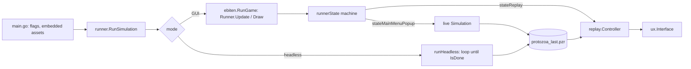
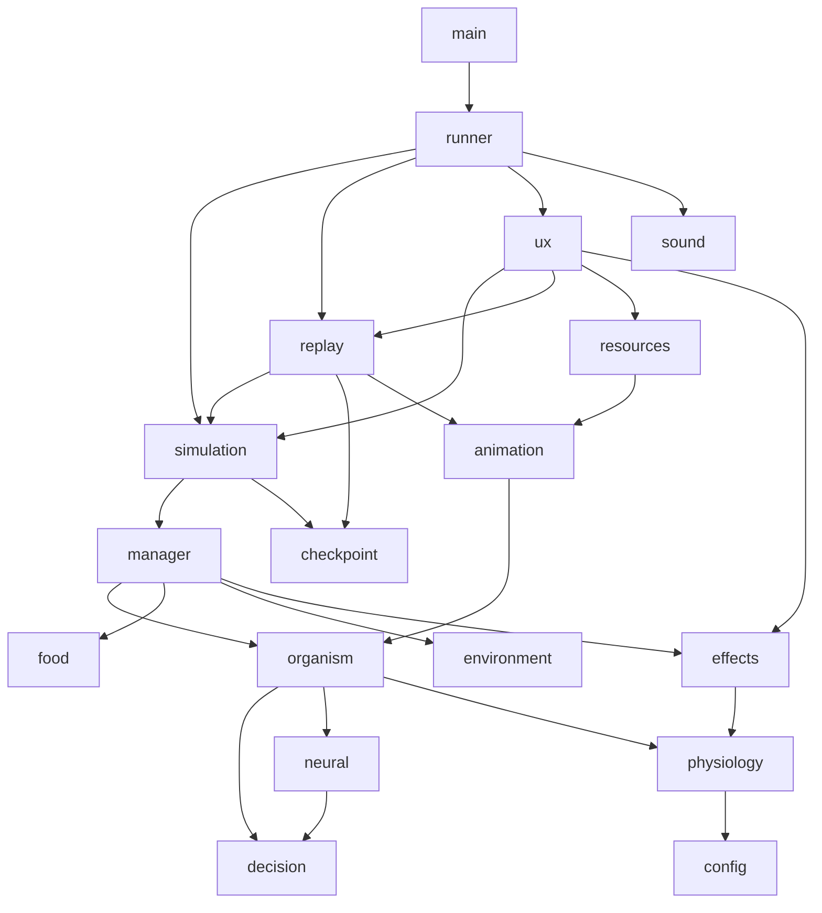
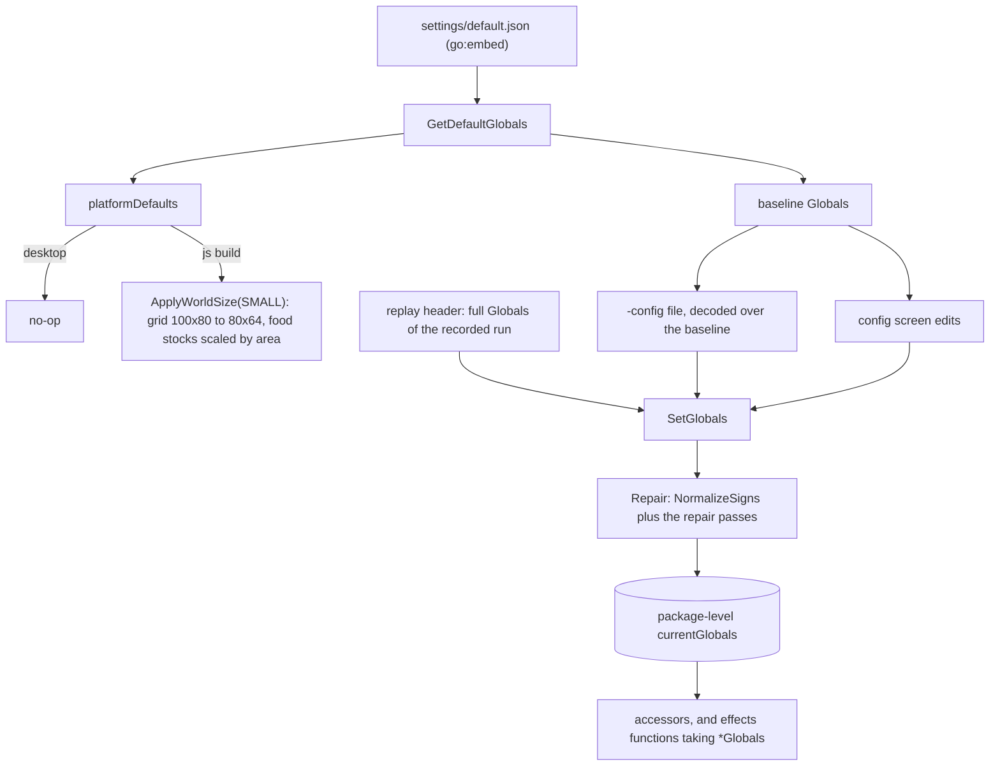
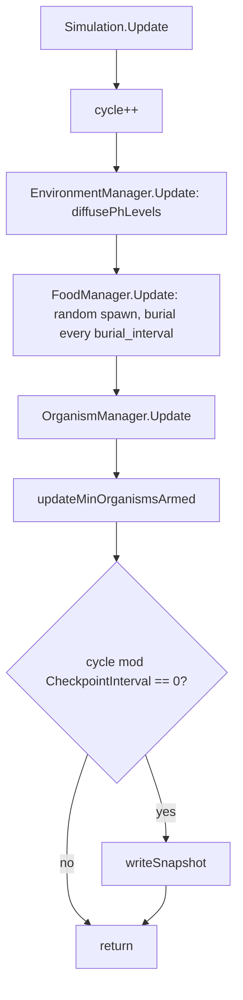
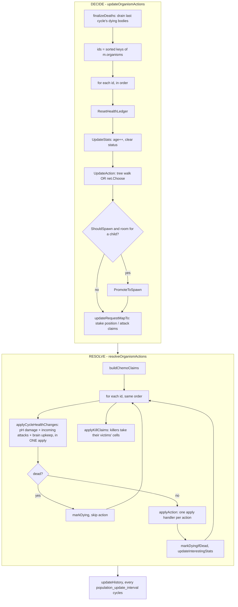
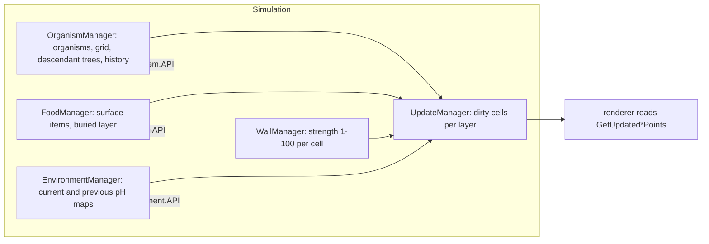
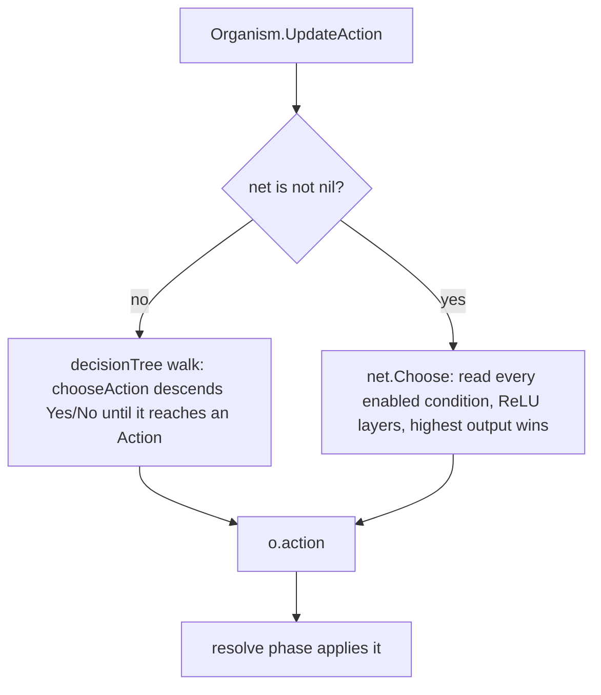
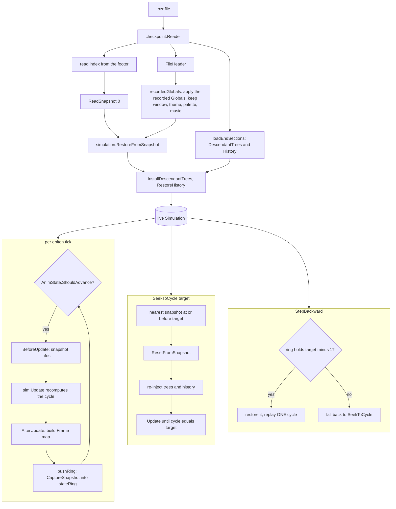
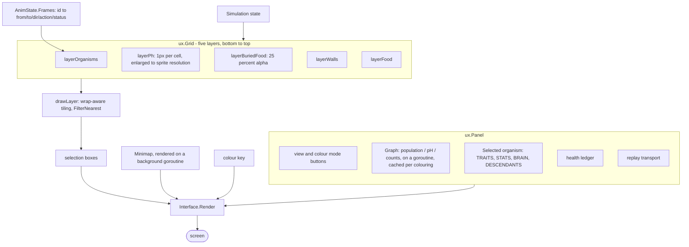

# Protozoa — architecture and program flow

A technical overview of how the program is put together: what each package
owns, how a cycle is computed, how a run is recorded and replayed, and how the
screen is drawn. It describes the code as it stands rather than the balance
decisions behind it — those are in `CLAUDE.md`.

Reading order: **Packages** for the map, **One cycle** for the core loop,
**Recording and replay** for the file format, **Rendering** for the UI.

---

## 1. The three things the program does

Every mode is built from the same `simulation.Simulation`. What changes is who
drives it and whether anything draws it.

| Mode | Entry | Drives the simulation | Draws |
|---|---|---|---|
| Live run | menu, New Simulation, or `-config` | `runner.stepSimulation`, time-budgeted per frame | `ux.SimPopup` (progress only) |
| Headless | `-headless`, `-trials N` | `runner.runHeadless`, a bare loop | nothing |
| Replay | menu, Load, or `-replay` / `-resume` | `replay.Controller.Update`, paced by `animation.State` | `ux.Interface` (full viewer) |

A live run and a headless run both **record**. The replay viewer **re-runs**
the recording: it restores a snapshot and calls the same `Simulation.Update`,
so a replayed cycle is computed, not played back from stored events.



---

## 2. Packages

Arrows are import direction. The rule that shapes the lower half of the graph:
`resources` imports `animation` imports `organism`, so **`organism` can never
import `resources`** — which is why derived appearance lives in `physiology`,
a package both sides can see.



### Simulation core

| Package | Owns |
|---|---|
| `simulation` | `Simulation`: the cycle counter, the RNG, the five managers, the recorder, end conditions. Mostly pass-through accessors — it is the facade every other package talks to. |
| `manager` | The five managers and all mutation of world state. `OrganismManager` is the largest file in the project and holds the decide/resolve loop. |
| `organism` | One organism: traits, ability scores, health, status, its brain, its per-cycle health ledger, its node in the descendant tree. |
| `food` | A food item (a cell and an int value) and the `food.API` the manager needs. |
| `environment` | The `environment.API` interface only; the pH map itself lives in `manager.EnvironmentManager`. |
| `utils` | `Point`, direction and wraparound helpers. Imported by nearly everything. |
| `simrand` | The RNG: a PCG source whose state marshals, which is what makes a snapshot resumable. |

### Behaviour and numbers

| Package | Owns |
|---|---|
| `decision` | Decision trees: node types, the registration tables, serialization, mutation, the condition families and the redundancy filter. |
| `neural` | Feed-forward networks: evaluation, structural mutation, gob serialization. The alternative brain. |
| `physiology` | Ability scores (`Scores`, the fixed point budget), the multiplier curves and their shapes, and derived `Appearance`. |
| `effects` | Every formula turning an ability score into an action's effect. Pure functions taking `*config.Globals` explicitly. |
| `config` | The `Globals` struct (one JSON tag per setting), accessors, CLI `Options`, the platform hook. |

### Recording and presentation

| Package | Owns |
|---|---|
| `checkpoint` | The `.pzr` format: writer, reader, record types, the wasm in-memory file, Save-Recording-As. |
| `replay` | `Controller`: seeking, stepping, speed, the in-memory state ring. |
| `animation` | `State`, the wall-clock pacer, and `Frame`, the per-organism from/to transition the renderer interpolates. |
| `resources` | Sprite sheets, fonts, the multi-zoom image sets, the embedded-asset hook. |
| `ux` | Everything drawn: grid layers, panel, graphs, minimap, config screen, menus, designer, document screens. About 60 files. |
| `sound` | Scene-based music: one set of pieces per scene, turn-taking, fades. |
| `runner` | The ebiten game loop and the screen state machine. |

---

## 3. Configuration

One mutable package-level `*Globals` in `config`, installed by `SetGlobals`
and read through per-setting accessors (`config.MaxOrganisms()`).



**World size is a preset, not three loose settings.** `config/world_size.go`
holds SMALL / MEDIUM / LARGE as one grid plus the two food stocks that go with
it — each dimension steps by 1.25, so the area steps by 1.5625 and the stocks
step with the area, keeping the density constant across sizes. **MEDIUM is what
`settings/default.json` ships**, enforced by `TestTheMediumWorldIsTheShippedDefault`,
and the browser's `platformDefaults` is `ApplyWorldSize(g, WorldSmall)`. The
settings screen's first row is the three buttons; `WorldSizeOf` reports which
one a configuration is on, or none when the grid or a stock has been
hand-edited. `ApplyWorldSize` writes fixed values rather than scaling what is
there, so clicking between sizes cannot compound.

Three properties worth knowing:

- **`SetGlobals` always runs `Repair()`.** A settings file or replay header
  written before a setting existed decodes that key to zero, which for several
  settings means "switched off" rather than "default". The repair passes fill
  those in; `NormalizeSigns` fixes damage stored under the old sign convention.
- **`effects` takes `*config.Globals` as an argument, never the global.** The
  config screen has to graph the values being *edited*, which are not installed
  until a run starts.
- **A replay installs its own recorded settings** (`replay.recordedGlobals`),
  keeping only the viewer's window size, theme, pH palette and music
  preference. A recording therefore runs as the world it recorded.

---

## 4. One cycle

`Simulation.Update` is the whole model. It is **single-threaded and
deterministic**: given a seed and a `Globals`, the sequence of cycles is fixed.
Nothing in the cycle reads a wall clock, and nothing that affects state ranges
a map.



### 4.1 The organism loop: decide, then resolve

`OrganismManager.Update` is two passes over the same sorted ID list, and the
split is what keeps the cycle order-independent.



**Why two passes.** Every organism decides against the world as it was at the
top of the cycle, so no organism sees another's move before deciding. Conflicts
are collected in `RequestManager` and arbitrated by a rule rather than by who
was reached first:

- `AddPositionRequest(p, id, size)` keeps the **largest** claimant, the higher
  ID breaking a tie. `GetPositionRequest` returns -1 for an unclaimed cell.
- `AddAttackRequest(p, amount, sourceID)` **appends**, so each hit keeps its
  source. The defender walks them individually — thorns and the attacker's
  share of the health removed both need to know who hit.

**Three ordering rules the code depends on:**

1. **The ID list is sorted.** Go's map order is randomised, so ranging the
   organism map directly would make the cycle non-deterministic.
2. **The health ledger is cleared in the DECIDE pass**, not the resolve loop.
   Thorns and predation credit the *attacker* while the *defender* resolves, so
   a clear inside the resolve loop wipes whichever of the two has the later ID.
3. **`applyKillClaims` runs after the resolve loop**, not inside it. An
   organism that changed cell mid-loop would otherwise be read for health
   effects at a cell it was not standing in when they were queued.

### 4.2 The managers



Managers do not hold each other. Each takes a narrow interface that
`*Simulation` satisfies (`organism.API`, `food.API`, `environment.API`), so a
manager reaches another only through the facade. That is also what makes the
managers testable against a stub.

`UpdateManager` is a set of dirty cells per layer. Every mutation flags the
cell it touched; the renderer drains the sets and repaints only those cells. A
mutation that forgets to flag produces a correct simulation and a stale
picture.

### 4.3 Brains

An organism holds **exactly one** of `decisionTree` and `net`, decided by the
world-level `use_neural_nets`. `UpdateAction` dispatches on which is set:



Both brains ask the same questions and choose between the same actions:
`decision.EnabledConditions()` in, `decision.EnabledActions()` out. The shared
read is `Organism.isConditionTrue`, so the two cannot answer the same question
differently.

They differ in how a child is made. A tree child copies the parent's tree and
applies at most one structural mutation (swap action, grow branch, swap
condition, prune branch — weighted). A net child copies every weight with a
small drift applied unconditionally, then at most one structural change
(add/remove input, add/remove output, add layer, widen/narrow layer).

---

## 5. Recording and replay

### 5.1 The `.pzr` file

Written forward as a run proceeds; the index is appended at `Close`.

```
+----------------------------------------------+
| Magic "PZR\0"                     4 bytes    |
| Version (2)                       uint32     |
| len(header)                       int32      |
| FileHeader (gob)                             |
|   Seed, CheckpointInterval                   |
|   GridUnitsWide/High                         |
|   Config  <- the full Globals, as JSON       |
+----------------------------------------------+
| Section xN                                   |
|   type   byte  (0x01 snapshot, 0x03 trees,   |
|                 0x04 history)                |
|   cycle  int32                               |
|   compressed len    int32                    |
|   uncompressed len  int32                    |
|   payload: gob, then DEFLATE                 |
|                                              |
|   0x01 Snapshot, every CheckpointInterval:   |
|     RNG state, organisms, organism grid,     |
|     food, buried food, walls,                |
|     current + previous pH maps, ancestors    |
+----------------------------------------------+
| 0x03 DescendantTrees  <- written at Close    |
| 0x04 History          <- written at Close    |
+----------------------------------------------+
| snapshotIndex (gob): [{cycle, fileOffset}]   |
| indexOffset        int64                     |
| len(index)         int32                     |
+----------------------------------------------+
```

Two consequences worth knowing:

- **The two end sections grow with every organism ever created**, not with the
  run length, so they are a small share of a short file and a third of a long
  one. `EstimatedReplayBytes` is therefore bytes-written plus
  `nodes * replayBytesPerNode` plus a fixed close overhead, and both constants
  round up — this drives the `max_replay_size_mb` cap, where over-estimating
  ends a run slightly early and under-estimating overruns the user's limit.
- **On wasm the file is a `MemFile`** in the `checkpoint` package's own
  registry, not anything the OS can see. `openWriterBacking` switches on
  `runtime.GOOS == "js"`, which is why the copy behind Save-Recording-As lives
  in `checkpoint` rather than in the viewer.

A snapshot stores the state needed to *continue the simulation*, not the state
needed to *draw* it. Display state — a net's activations, the health ledger,
the decision path — is rebuilt by playing a cycle, which is why `StepBackward`
restores the cycle before its target and plays one.

### 5.2 Opening and seeking



`stateRing` is a 100-entry ring of recent snapshots kept in memory, so stepping
back a cycle during playback costs a restore and one cycle rather than a disk
seek and a run-up from the last checkpoint.

### 5.3 Why determinism is load-bearing

A replay is a re-computation, so anything that changes the order or the count
of RNG draws changes the run from that point on. What that constrains:

- The organism loop is **sequential**. A parallel decide phase was tried and
  broke replay determinism.
- `physiology.AllAbilities` and the `decision` registration tables are iterated
  **in declaration order**; a reordered table changes which node a given draw
  lands on.
- Mutation takes **one draw to pick a kind** whatever the weights are
  (`decision.pickFirst`, `neural.pickWeighted`), so a settings change alters
  which mutation lands, never how many values it consumes.
- `physiology.RandomScores` spills over-cap points rather than redrawing — a
  reject-and-retry loop would consume a variable number of draws.
- Floating-point **operation order** in `effects` is fixed. Interpolating and
  then scaling is the same algebra and a different float, and one ulp on a
  threshold is a different decision and a diverged replay from there on.
- Snapshots store sim-affecting floats at **float64**; float32 caused drift.
- Restore paths **deep-copy** snapshot data rather than aliasing it, or
  forward-play corrupts the ring's own snapshots.

---

## 6. Rendering

The renderer is read-only. It samples the simulation and `AnimState.Frames`
and never mutates world state.



### What makes it cheap

- **Incremental layers.** Each layer image persists between frames; only cells
  the `UpdateManager` flagged are repainted. A full repaint happens on a camera
  change, a colour-mode change or a seek.
- **Precompute at stable boundaries.** Anything that walks the descendant tree
  or scans the whole pH map is computed once where its inputs change, not per
  frame. `mostSuccessful` is built in `RestoreDescendantTrees`; the family-tint
  memo back-fills every node it passes and is keyed on the selection and the
  tree generation.
- **Background goroutines for the two slow pictures.** The minimap and the
  graphs render off the main goroutine and hand results back through a channel
  or an atomic pointer; what they read is captured by value first.

### Pacing

`animation.State` is the wall clock. At speed 1 a cycle occupies a fixed window
and the sprite animation plays across it; at higher speeds the window shrinks
and several `Update` calls may fire per tick; below 1 it stretches. Speeds are
snapped to powers of two. A live run instead gets a **time budget per frame**
(`stepSimulationBudget`, 25ms) so the window stays responsive while the sim
runs as fast as it can.

### Sprites

`resources` holds images keyed `map[ImageRole]LayeredFrames`, where
`LayeredFrames` is `map[Layer]FrameSet` and `FrameSet` is
`map[animation.Animation][]*ebiten.Image`. Three sets are loaded (4x4, 8x8,
16x16) and `SelectZoom` switches the active one — but `zoomSpriteSet` is
`{0, 2, 2, 2, 2}`, so only the 4x4 and 16x16 sets are ever selected. The 8x8
set is loaded and nothing points at it: only the 16x16 art carries the layered
overlays, so Zoom8 draws that downscaled with a linear filter instead. A
downscale is the one case that is filtered; an upscale stays nearest, or pixel
art blurs.

An organism's sprite is composited from the layers its `physiology.Appearance`
unlocks — body class, motor, mouth, sensors — tinted multiplicatively, so white
source art takes the full target colour and grey shading is preserved.

---

## 7. Where to change what

| To change | Go to |
|---|---|
| A balance number | `config/globals.go` (struct + accessor), `settings/default.json`, `ux/config_screen.go`, `ux/config_tooltips.go` |
| What an action is worth | `effects/effects.go` — never a second copy elsewhere |
| How an ability scales | `physiology/curve.go`, plus six maps in `ux/ability_graphs.go` |
| A new action or condition | `decision/constants.go`, the registration tables, `MutableActions` / `MutableConditions`, `settings/default.json`'s `disabled_decision_nodes` |
| What one action does to the world | the matching `applyX` in `manager/organism.go` |
| Anything saved in a replay | `checkpoint/types.go`, `manager/capture.go`, `simulation/restore.go` — all three |
| A new grid layer or colour mode | `ux/grid.go` (`layerType`, `allOrgColorModes`) and `ux/color_key.go` |
| A new screen | `runner/runner.go` (`runnerState`, before `stateCount`) and `runner/music.go`'s `stateScenes` |

### Invariants a change has to keep

- **One source for a formula.** `effects` is it. The config screen's graphs and
  the simulation call the same function, so a graph cannot drift from the world
  it describes.
- **A list that is iterated is declaration-ordered and has one canonical copy.**
  `AllAbilities`, `AllCurves`, `AllHistoryTypes`, `allRunnerStates`,
  `allOrgColorModes`. A second hand-written copy is the recurring bug in this
  codebase; the fix is always one list plus a test that walks it.
- **Anything registered in two places will be registered in one.** Where that
  is unavoidable, a test walks the canonical list against every registry —
  `TestEveryCurveIsRegisteredEverywhere`, `TestEverySettingIsReachableOnScreen`,
  `TestEveryStateNamesAScene`.
- **Don't re-derive snapshot state for display.** If the panel needs something
  a snapshot does not carry, play a cycle; do not store seven floats per
  organism per snapshot for a readout.

---

## 8. Running it

```bash
go run .                                  # splash, menu
go run . -config settings/default.json    # skip the config screen
go run . -headless -trials 5              # no GUI
go run . -replay path/to/run.pzr          # open a recording
go run . -resume                          # reopen the last run's recording
go run . -dump-config                     # print the default Globals as JSON

./test.sh                                 # go test -timeout 40m ./...
./test.sh ./manager/ -run Kill            # arguments pass through

./web/build.sh                            # GOOS=js GOARCH=wasm, into web/
./dist.sh                                 # stage dist/web and dist/windows
./push.sh <user>/<game>                   # upload both to itch.io with butler
```

**Use `./test.sh`, not `go test ./...`.** Go's default timeout is 10 minutes
per package and the `simulation` package does not fit it.

**The js build has tests of its own that `./test.sh` does not run**, because
executing them needs a wasm runner. They are the `//go:build js` files —
today `config/platform_js_values_test.go`, which checks that the browser hook
really is `BrowserDefaults`. To run them, point `-exec` at Go's node shim
(`$(go env GOROOT)/lib/wasm/wasm_exec_node.js`); on Windows that needs a small
`.bat` wrapper, since the shipped `go_js_wasm_exec` is a shell script:

```bash
GOOS=js GOARCH=wasm go test -exec="$(go env GOROOT)/lib/wasm/go_js_wasm_exec" ./config/
```

Worth doing after any change to `config/world_size.go`. A desktop-only
assertion left untagged compiles into the wasm test binary too, and fails
there silently — `TestPlatformDefaultsLeaveTheDesktopBaselineAlone` is tagged
`!js` for exactly that reason.

Many measurement probes are environment-gated tests that assert nothing; they
exist so a balance question can be measured rather than guessed. They are named
`zz_*_test.go` and each one's header comment gives its invocation — for example
`WASM_DEFAULTS=1 go test ./simulation/ -run TestWasmDefaultsProbe -v`.
